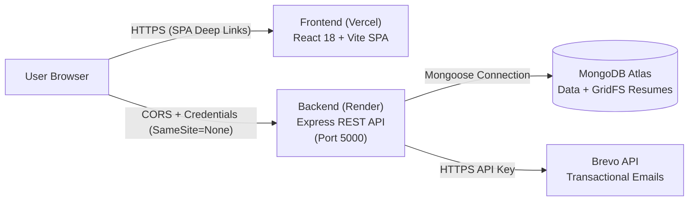

# Production Deployment Guide: MongoDB Atlas, Render & Vercel

This step-by-step guide walks through deploying the Placement Portal across:
- **Database & Persistent File Storage**: [MongoDB Atlas](https://www.mongodb.com/atlas) (with MongoDB GridFS for resume storage)
- **Backend API Server**: [Render](https://render.com) (Node.js + Express with `render.yaml`)
- **Frontend Web Application**: [Vercel](https://vercel.com) (React 18 + Vite with `client/vercel.json`)
- **Transactional Emails**: [Brevo](https://www.brevo.com) (HTTPS API via native `fetch`) or SMTP

---

## Architecture Summary



---

## Prerequisites

1. A [GitHub](https://github.com) account containing this repository.
2. A free or dedicated [MongoDB Atlas](https://www.mongodb.com/atlas) account.
3. A [Render](https://render.com) account.
4. A [Vercel](https://vercel.com) account.
5. A [Brevo (Sendinblue)](https://www.brevo.com) account (or standard SMTP credentials).

---

## Step 1: MongoDB Atlas Setup

1. **Create an Atlas Cluster**:
   - Log in to [MongoDB Atlas](https://cloud.mongodb.com).
   - Select **Create a Deployment** and choose **M0 Free Tier** (or higher).
   - Select your preferred cloud provider (AWS/GCP/Azure) and nearest geographic region.
   - Click **Create Deployment**.

2. **Configure Database User Credentials**:
   - In the left sidebar, navigate to **Security** $\rightarrow$ **Database Access**.
   - Click **Add New Database User**.
   - Select **Password Authentication**.
   - Enter a username (e.g. `placement_app_user`) and a secure generated password.
   - Set **Database User Privileges** to `Read and write to any database`.
   - Click **Add User**.

3. **Configure Network IP Access**:
   - In the left sidebar, navigate to **Security** $\rightarrow$ **Network Access**.
   - Click **Add IP Address**.
   - Choose **Allow Access from Anywhere** (`0.0.0.0/0`).
     *(Required for serverless / dynamic cloud hosts like Render without dedicated static outbound IPs).*
   - Click **Confirm**.

4. **Obtain Connection String**:
   - Navigate to **Deployments** $\rightarrow$ **Database**.
   - Click **Connect** on your cluster.
   - Select **Drivers** (Node.js).
   - Copy the SRV URI connection string:
     ```text
     mongodb+srv://<username>:<password>@cluster0.abcde.mongodb.net/placement_management?retryWrites=true&w=majority
     ```
   - Replace `<username>` and `<password>` with the credentials created in Step 1.2. Make sure the database name is set to `placement_management`.

> [!NOTE]
> **Resume Storage in GridFS**: When `STORAGE_DRIVER=gridfs` is active, uploaded PDF resumes are stored directly in Atlas under the `resumes.files` and `resumes.chunks` collections. No Amazon S3 or Google Cloud Storage setup is required!

---

## Step 2: Render Backend Deployment

The repository includes a ready-to-use Render Blueprint (`render.yaml`). You can deploy using Blueprint or manually.

### Option A: Automatic Blueprint Deployment (Recommended)
1. Go to [Render Dashboard](https://dashboard.render.com).
2. Click **New** $\rightarrow$ **Blueprint**.
3. Select your GitHub repository.
4. Render will parse `render.yaml` and configure the web service with:
   - Root Directory: `server`
   - Build Command: `npm ci`
   - Start Command: `node server.js`
   - Health Check Path: `/api/health`
5. Fill in the prompted secret variables (see below).

### Option B: Manual Web Service Setup
1. Go to [Render Dashboard](https://dashboard.render.com).
2. Click **New** $\rightarrow$ **Web Service**.
3. Connect your GitHub repository.
4. Configure the settings:
   - **Name**: `placement-management-server`
   - **Region**: Choose the region closest to your MongoDB Atlas cluster.
   - **Root Directory**: `server`
   - **Runtime**: `Node`
   - **Build Command**: `npm ci`
   - **Start Command**: `node server.js`
   - **Plan**: `Free` (or higher)
5. Expand **Advanced** and set:
   - **Health Check Path**: `/api/health`

### Required Environment Variables on Render

Under the **Environment** tab, configure the following keys:

| Environment Variable | Recommended Production Value | Description |
|---|---|---|
| `NODE_ENV` | `production` | Enables production cookie flags (`SameSite=None; Secure`), strict secrets checks, and disables demo OTPs |
| `PORT` | `5000` | Port listened to by Node Express (Render maps this automatically) |
| `STORAGE_DRIVER` | `gridfs` | Enables MongoDB GridFS for persistent resume uploads |
| `EMAIL_PROVIDER` | `brevo` | Outbound email delivery provider (`brevo` or `smtp`) |
| `EMAIL_MODE` | `brevo` | Delivery mode (`brevo`, `smtp`, or `console`) |
| `CLIENT_URL` | `https://your-app.vercel.app` | Allowed CORS origin. Supports comma-separated list of origins for preview branches |
| `MONGO_URI` | `mongodb+srv://...` | MongoDB Atlas connection string from Step 1 |
| `JWT_SECRET` | *32+ character random string* | Secret key for signing short-lived access tokens (min 32 chars in production) |
| `JWT_REFRESH_SECRET` | *32+ character random string* | Secret key for signing 7-day refresh tokens |
| `BREVO_API_KEY` | `xkeysib-...` | API key from your Brevo account (Settings $\rightarrow$ SMTP & API) |
| `BREVO_SENDER_EMAIL` | `noreply@yourdomain.com` | Verified sender address in Brevo |
| `BREVO_SENDER_NAME` | `Placement Portal` | Display name on outbound emails |
| `ALLOW_PRODUCTION_SEED` | `false` | Safeguard against accidental demo database wipes in production |

> [!WARNING]
> **Render Free Tier Spin-Down & Scheduled Jobs**:
> Render free instances spin down after 15 minutes without incoming HTTP traffic. When asleep, Node.js background timers (`node-cron`) for interview reminders and application auto-closing pause until traffic arrives.
> To ensure cron tasks fire reliably on the free tier:
> Configure a free monitoring service like [UptimeRobot](https://uptimerobot.com) or [Cron-Job.org](https://cron-job.org) to send an HTTP GET request to `https://<your-service>.onrender.com/api/health` every **10 minutes**.

---

## Step 3: Vercel Frontend Deployment

1. Go to [Vercel Dashboard](https://vercel.com/dashboard).
2. Click **Add New...** $\rightarrow$ **Project**.
3. Import your GitHub repository.
4. Configure the project:
   - **Framework Preset**: `Vite`
   - **Root Directory**: Click `Edit` and select `client`.
   - **Build Command**: `npm run build`
   - **Output Directory**: `dist`
5. Under **Environment Variables**, add:
   - `VITE_API_BASE_URL` = `https://<your-render-backend-url>.onrender.com/api`
     *(Make sure to append `/api` at the end).*
6. Click **Deploy**.
7. Once deployment finishes, copy your live Vercel URL (e.g. `https://placement-system.vercel.app`).
8. Return to Render $\rightarrow$ **Environment**, ensure `CLIENT_URL` matches your exact Vercel URL (without trailing slash), and save changes.

> [!NOTE]
> **Client Deep Linking & React Router**: The repository includes `client/vercel.json` with a rewrite rule `/(.*) -> /index.html`. This ensures that refreshing any deep URL (such as `/login`, `/admin/drives`, or `/aspirant/explore`) loads the application without 404 errors.

---

## Step 4: Provision the Initial Superadmin Account

The production database is empty and protected against demo data scripts (`ALLOW_PRODUCTION_SEED=false`). To create the first platform superadmin:

1. In the **Render Dashboard**, open your web service and click the **Shell** tab (or run locally pointed to your Atlas URI).
2. Run the dedicated provisioning command:
   ```bash
   SUPERADMIN_EMAIL="superadmin@yourdomain.com" SUPERADMIN_PASSWORD="YourStrongPassword123" npm run seed:superadmin
   ```
3. The script creates the root superadmin account with `role: "superadmin"`, `isApproved: true`, and `isEmailVerified: true`.
4. You can now log into your live Vercel frontend at `/login` with these superadmin credentials!

---

## Step 5: Resume Migration (If Upgrading Existing Data)

If you are migrating existing student profiles whose resumes were saved on local disk (`/uploads/...`) to MongoDB GridFS:

1. Open the **Shell** tab in the Render Dashboard (or run from your machine configured with the database `MONGO_URI`).
2. Run the idempotent migration utility:
   ```bash
   node utils/migrateResumesToGridfs.js
   ```
3. The script scans all student profiles, transfers existing files from local disk into the GridFS `resumes` bucket, and updates each record's `resumeUrl` to `gridfs:<fileId>`. Re-running the script is safe and performs a no-op on already migrated records.

---

## Step 6: Post-Deployment Smoke Test Checklist

Perform this verification checklist after completing deployment:

- [ ] **1. Health Endpoint Check**:
  - Visit `https://<your-backend>.onrender.com/api/health` in your browser.
  - Expected JSON response: `{"status": "ok", "db": "connected"}` with HTTP 200.
- [ ] **2. Frontend Deep Linking**:
  - Open `https://<your-frontend>.vercel.app/login`.
  - Refresh the browser page (`Ctrl+R` / `Cmd+R`). Page reloads without a 404 error.
- [ ] **3. Cross-Site Refresh Cookie**:
  - Log in using your superadmin credentials.
  - Open Browser DevTools $\rightarrow$ **Application** $\rightarrow$ **Cookies**.
  - Verify that the cookie `refreshToken` has:
    - `HttpOnly`: Checked
    - `Secure`: Checked
    - `SameSite`: `None`
- [ ] **4. Outbound Transactional Email**:
  - Register a new account or trigger a password reset for a test email.
  - Verify receipt in your email inbox via Brevo/SMTP.
- [ ] **5. Resume Upload & Streaming**:
  - Log in as a student, upload a valid PDF resume under profile settings.
  - Click **View Resume** or **Download Resume**.
  - Verify the resume streams directly from MongoDB GridFS through `GET /api/students/:id/resume`.
- [ ] **6. Institutional & Recruiter Approval Flow**:
  - Register a demo recruiter or TPO account.
  - Superadmin approves account in `/superadmin/pending-accounts`.
  - Recruiter / TPO receives approval email and gains dashboard access.
- [ ] **7. Uptime Keep-Alive**:
  - Configure [UptimeRobot](https://uptimerobot.com) to ping `GET /api/health` every 10 minutes to maintain active in-process cron schedules.

