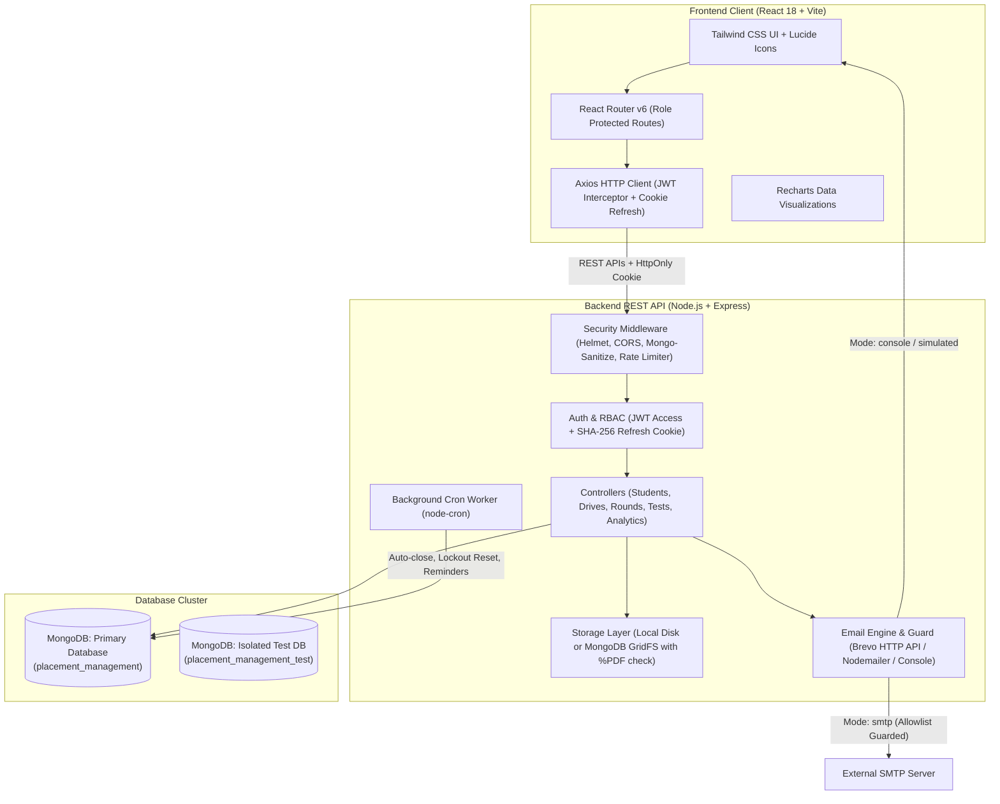
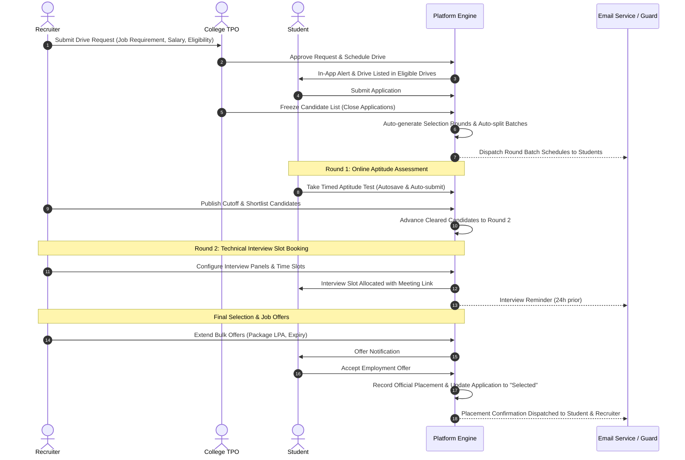

# Campus Placement & Recruitment Management System

[](https://github.com/Krunalsinh27/ai-placement-platform/actions/workflows/ci.yml)

An enterprise-grade, multi-tenant higher education recruitment platform connecting colleges, engineering and management students, recruiting corporations, independent accreditation analysts, and prospective students into a unified campus hiring lifecycle. The system provides secure role-based portals for publishing job requirements, submitting institutional drive requests, managing multi-stage selection pipelines (automated batching, proctored aptitude tests, interview slot booking, and attendance tracking), extending formal offers, and benchmarking institutional placement records with differential privacy protections.

> **Synthetic Data Notice**: All demonstration accounts, institutional profiles, student names, and employer data seeded in this repository are entirely synthetic and generated strictly for evaluation, testing, and demonstration purposes.

---

## Architecture & System Overview



---

## User Roles & Capabilities

| Role | Key Capabilities & Permissions |
|---|---|
| **`student`** | Complete academic profile (branch, CGPA, backlogs, skills), upload verified PDF resume, explore eligible on-campus drives, apply for drives, take on-platform aptitude tests, track stage timelines, accept/decline offers. |
| **`tpo`** | Training & Placement Officer. Manage college student rosters, approve pending colleague TPOs and enrolled students, review recruiter drive requests, schedule on-campus drives, freeze applicant lists, run auto-batching, track attendance, and export placement reports. |
| **`admin`** | Institutional placement director. Manages institutional settings (such as student auto-approval toggles), overseas college-wide placement statistics, and controls local college operations. |
| **`recruiter`** | Corporate talent acquisition. Register company profile, create hiring requirements, submit campus drive requests, configure evaluation rounds (online aptitude, external links, offline interviews), manage interview panels & candidate slots, extend job offers. |
| **`superadmin`** | Root platform administrator. Approves/rejects new educational institutions, verifies corporate employer accounts, authorizes observer analysts, and exercises platform-wide account approval overrides. |
| **`analyst`** | Independent observers and researchers. Explore cross-institutional placement analytics, track average/median/highest package distributions, compare up to 3 colleges, and export anonymized data to PDF or Excel. |
| **`aspirant`** | Prospective students and parents. Explore verified colleges, filter by all 36 Indian states and UTs, review transparent branch placement rates, and receive personalized recommendations based on home state and preferred disciplines. |

---

## End-to-End Recruitment Pipeline Flow



---

## Key Features

1. **Multi-Stage Recruitment Pipeline**:
   - Customizable round stages (Aptitude, Coding, Technical Interview, HR Interview, Group Discussion).
   - Multi-delivery modes: on-platform test, external link (Google Meet / Zoom / MS Teams), and offline on-campus venues.
   - Intelligent batch auto-splitting in enrollment order with conflict and institutional venue clash detection.
2. **On-Platform Aptitude Engine**:
   - CSV question bank import with automated category, question, and option parsing.
   - Test window enforcement with hard start/end timestamps and per-student time countdowns.
   - Secure autosave, single-attempt guard, and background cron auto-submission upon window expiration.
3. **Privacy-Preserving Institutional Analytics**:
   - Small-group data suppression (`< 5` students) protecting individual candidate identities across all aggregate queries.
   - Dynamic cross-college comparison matrix with salary percentiles (average, median, top 10%).
   - Multi-format executive exports: multi-sheet Excel workbooks (`exceljs`) and publication-ready PDF reports (`pdfkit`).
4. **Prospective Student (Aspirant) Intelligence**:
   - Transparent placement statistics for pre-admission discovery.
   - Recommendation ranking engine weighted by discipline-specific placement rates and home-state tie-breaking.
   - Complete 36 States & Union Territories directory filter with live college count indicators.
5. **Robust Multi-Tenancy & Access Scoping**:
   - Complete institutional data isolation: TPOs and Admins are restricted strictly to their assigned college tenant.
   - Recruiters are scoped strictly to their corporate entity and confirmed drives.
6. **Hardened Communication & Email Queue**:
   - In-memory asynchronous queue worker with exponential retry backoff (`1s`, `5s`, `30s`) and permanent 5xx failure skipping.
   - Comprehensive safety guard with test simulation logging, fake domain rejection, and sliding-window rate capping.

---

## Tech Stack

| Layer | Technologies |
|---|---|
| **Frontend** | React 18, Vite, React Router v6, Tailwind CSS, Lucide React, Recharts, React Hot Toast, Axios |
| **Backend** | Node.js, Express.js (CommonJS), Mongoose ODM, JSON Web Tokens, Bcrypt.js, Cookie-Parser |
| **Security & Hardening** | Helmet, Express Mongo Sanitize, Express Rate Limit, Multer (%PDF magic bytes), CORS |
| **Reporting & Documents** | PDFKit, ExcelJS, CSV Parser |
| **Task Scheduling & Email** | Node-Cron, Nodemailer (with custom delivery guard & queue worker) |
| **Database** | MongoDB 7.0+ (Indexes, Compound Indexes, Unique Constraints) |
| **Testing & CI** | Custom Node.js Test Harness, GitHub Actions (Ubuntu, Node 20, MongoDB service container) |

---

## Setup & Installation

### Prerequisites
- **Node.js**: v18.0.0 or higher (v20+ recommended)
- **MongoDB**: v6.0 or higher running locally on `localhost:27017` or a cloud MongoDB Atlas URI
- **Git**

### 1. Clone Repository & Install Dependencies
```bash
# Clone the repository
git clone https://github.com/ai-placement-platform/placement-system.git
cd placement-system

# Install server dependencies
cd server
npm install

# Install client dependencies
cd ../client
npm install
cd ..
```

### 2. Environment Variables Configuration

Copy `.env.example` templates to `.env` in both `/server` and `/client`:

```bash
cp server/.env.example server/.env
cp client/.env.example client/.env
```

#### Server Configuration (`server/.env`):
| Variable | Required | Default / Example Value | Description |
|---|---|---|---|
| `PORT` | Optional | `5000` | Backend API port |
| `NODE_ENV` | Optional | `development` | Runtime environment (`development`, `production`, `test`) |
| `MONGO_URI` | **Required** | `mongodb://127.0.0.1:27017/placement_management` | Main MongoDB connection URI |
| `MONGO_URI_TEST` | Optional | `mongodb://127.0.0.1:27017/placement_management_test` | Isolated database used for automated tests |
| `JWT_SECRET` | **Required** | `your_secure_random_key_min_32_characters_long` | Secret for signing JWTs (must be >= 32 chars) |
| `JWT_EXPIRES_IN` | Optional | `15m` | Access token duration |
| `REFRESH_TOKEN_EXPIRES_DAYS` | Optional | `7` | Refresh token duration in days |
| `CLIENT_URL` | Optional | `http://localhost:5173` | Allowed CORS origin |
| `EMAIL_MODE` | Optional | `console` | `smtp` for real emails, `console` for safe dev logging |
| `SMTP_HOST` | Optional | `smtp.gmail.com` | SMTP relay server host |
| `SMTP_PORT` | Optional | `587` | SMTP port (587 for STARTTLS, 465 for SSL) |
| `SMTP_USER` | Optional | `your-email@gmail.com` | SMTP username / address |
| `SMTP_PASS` | Optional | `xxxx xxxx xxxx xxxx` | SMTP app password |
| `MAIL_FROM` | Optional | `Placement Portal <no-reply@portal.com>` | Outgoing sender header |
| `EMAIL_DEV_ALLOWLIST` | Optional | `your.dev.email@gmail.com` | Comma-separated addresses permitted in dev SMTP |
| `EMAIL_MAX_PER_MINUTE` | Optional | `20` | Sliding window rate cap on SMTP dispatches |

#### Client Configuration (`client/.env`):
| Variable | Required | Default Value | Description |
|---|---|---|---|
| `VITE_API_URL` | Optional | `http://localhost:5000/api` | Base URL pointing to Express backend |

### 3. Seed Database
Populate the database with synthetic colleges, companies, recruiters, TPOs, students, applications, and placement metrics:
```bash
cd server
npm run seed
```

### 4. Run the Development Servers

Start the backend API server:
```bash
# In /server terminal
npm run dev
# Server starts on http://localhost:5000
```

Start the Vite frontend development server:
```bash
# In /client terminal
npm run dev
# Frontend starts on http://localhost:5173
```

---

## Development Email Guard Behavior

To prevent accidental spamming or inbox flooding during local development and testing, the platform features a centralized delivery guard in `server/utils/emailService.js`:

1. **Console Simulation Mode (`EMAIL_MODE=console`)**:
   - Outgoing emails are intercepted, formatted cleanly, and printed directly to the terminal stdout.
   - OTP codes are rendered in a visible simulation box for immediate copy-pasting.
2. **Real SMTP Guard (`EMAIL_MODE=smtp`)**:
   - Real email dispatch is allowed **only if ALL of the following conditions are met**:
     - `EMAIL_MODE === 'smtp'` and SMTP credentials are fully configured.
     - `NODE_ENV !== 'test'` (automated tests never send real emails).
     - The recipient domain is **NOT** in the blocked domain blacklist (`portal.com`, `college.com`, `example.com`, etc.).
     - Either `NODE_ENV === 'production'` OR the recipient email is explicitly present in the comma-separated `EMAIL_DEV_ALLOWLIST` environment variable.
3. **Permanent Failure Handling**:
   - Permanent SMTP errors (HTTP 5xx status codes, "user unknown", "mailbox not found") are detected immediately and marked failed with 0 retries, preventing endless queue retry loops.
4. **Rate Capping**:
   - Outgoing dispatches are throttled by `EMAIL_MAX_PER_MINUTE` (default 20/min) using an in-memory sliding window.

---

## Automated Testing & CI

### Running the Test Suite
The backend contains 12 automated test suites that run sequentially against an isolated test database (`placement_management_test`).

```bash
# Run all automated test suites sequentially
cd server
npm run test:all
```

#### Individual Test Suites:
```bash
npm run test:emailguard   # Email guard, blocked domains, allowlist, rate limits
npm run test:auth         # Password rules, OTP flows, lockout, student approval
npm run test:colleges     # College lifecycle, multi-tenant isolation, TPO scoping
npm run test:notifications# Notification events, drive alerts, applicant triggers
npm run test:pipeline     # Drive freeze, selection rounds, batch split, attendance
npm run test:interviews   # Panel scheduling, unique links, candidate slot booking
npm run test:emails       # HTML templates, queue worker retries, cron reminders
npm run test:delivery     # Delivery modes (online/link/offline), attendance PDFs
npm run test:aptitude     # Aptitude question bank, timed attempts, auto-submit
npm run test:analyst      # Analyst RBAC, small-group masking (<5), analytics exports
npm run test:superadmin   # Platform overview, account approvals, public directory
npm run test:aspirant     # Aspirant preferences, recommendations, 36-state filter
```

#### Manual Verification Scripts (with running server):
```bash
# Test all live role logins and paginated endpoints
node tests/verifyLiveServerAndClient.js

# Test security hardening (resume RBAC, recruiter approval, token refresh)
node tests/verifySecurityHardening.js
```

### Continuous Integration (CI)
GitHub Actions workflow is located at `.github/workflows/ci.yml`. On every push and pull request to `main` or feature branches, the pipeline:
- Spins up a `mongo:7.0` health-checked service container on port `27017`.
- Sets up Node.js 20 with package-lock caching.
- Executes `npm ci` and runs `npm run test:all` in `/server`.
- Executes `npm ci` and verifies production bundle build via `npm run build` in `/client`.

---

## Demo Login Credentials

All demonstration accounts are seeded with consistent passwords meeting platform complexity rules (at least 8 characters, with letters and numbers):

| Role | Email Address | Password | Details / Assigned Organization |
|---|---|---|---|
| **Superadmin** | `superadmin@portal.com` | `Super@12345` | Platform Root Administrator |
| **College TPO / Admin** | `admin@college.com` | `Admin@123` | National Institute of Technology Delhi (NITD) |
| **College TPO** | `tpo.pune@college.com` | `Admin@123` | Pune Institute of Computer Technology (PICT) |
| **Recruiter** | `recruiter@google.com` | `Recruiter@123` | Google Campus Talent Partner |
| **Student** | `aarav.sharma1@college.com` | `Student@123` | NIT Delhi - CSE (Final Year) |
| **Analyst / Observer** | `analyst@portal.com` | `Analyst@123` | Higher Education Analytics Board |
| **Aspirant** | `aspirant@portal.com` | `Aspirant@123` | Prospective Student (State: Delhi) |

---

## Production Deployment & Cloud Architecture

The platform is designed for turnkey cloud deployment with zero additional cloud storage dependencies:

- **Frontend Client**: Hosted on [Vercel](https://vercel.com) as a single-page application configured with `client/vercel.json` for React Router deep linking.
- **Backend API**: Hosted on [Render](https://render.com) using the root Blueprint definition `render.yaml`.
- **Database & Object Storage**: Hosted on [MongoDB Atlas](https://www.mongodb.com/atlas). Resumes are stored directly in Atlas using MongoDB GridFS (`STORAGE_DRIVER=gridfs`), avoiding external S3 buckets while surviving Render's ephemeral filesystem redeploys.
- **Transactional Email**: Supported via Brevo HTTPS API (`EMAIL_PROVIDER=brevo`) or standard SMTP (`EMAIL_PROVIDER=smtp`), fully guarded against test recipient bounces and domain flooding.
- **Initial Setup**: Run `npm run seed:superadmin` to safely provision the first platform superadmin without demo data.
- **Health Check & Keep-Alive**: The API exposes `GET /api/health` returning `{ status: "ok", db: "connected" }`.
  > [!NOTE]
  > **Render Free Tier & In-Process Cron Jobs**: Render free tier instances spin down after 15 minutes of inactivity. When asleep, in-process timers and `node-cron` schedules (such as interview reminders and application auto-closing) pause until the next incoming request wakes the instance. To keep scheduled jobs running on time without upgrading to a paid instance, configure an external uptime monitor (e.g. [UptimeRobot](https://uptimerobot.com) or [Cron-Job.org](https://cron-job.org)) to ping `GET /api/health` every 10 minutes.

For comprehensive, step-by-step instructions on deploying MongoDB Atlas, Render, and Vercel, refer to [DEPLOY.md](DEPLOY.md).

---

## Security & Hardening Measures

- **Recruiter & Corporate Approval**: Newly registered recruiters default to `isApproved: false` and their companies default to `verified: false`. Superadmins review credentials in a dedicated verification dashboard prior to allowing drive creation.
- **Resume Access Control & IDOR Prevention**: Static file serving for resume uploads is disabled. Resumes are streamed via an authenticated route (`GET /api/students/:studentId/resume`) enforcing multi-tenant authorization (student owner, same-college TPO, recruiter with active application, superadmin). Direct upload requests validate `%PDF` magic byte headers.
- **Short-Lived Tokens & Refresh Rotation**: Access tokens expire in 15 minutes. Long-lived refresh tokens (7 days) are transmitted in `httpOnly`, `sameSite` secure cookies. Refresh token hashes (SHA-256) are stored in MongoDB and revoked on logout or password reset. Axios automatically recovers expired sessions via an in-flight queueing interceptor.
- **Account Lockout & Brute-Force Defense**: Five consecutive failed login attempts trigger an automatic 15-minute account lockout (`HTTP 423 Locked`).
- **HTTP Hardening Middleware**: Express server is fortified with `helmet`, `express-mongo-sanitize` (NoSQL injection prevention), strict CORS binding to `CLIENT_URL`, `100kb` request body caps, and IP-based rate limiting on public endpoints.
- **Startup Secret Validation**: In production mode, the server refuses startup if `JWT_SECRET` is unset or fewer than 32 characters in length.

---

## Roadmap

1. **Off-Campus & Pooled Walk-in Drives**: Support multi-college joint recruitment pooling, where anchor institutions host shared physical drives with distributed candidate quotas.
2. **AI-Assisted Resume & Skill Gap Matching**: Automated semantic parsing of candidate resumes against job requirement skill vectors to recommend candidates and highlight curriculum skill gaps.
3. **Alumni Interview Experience Repository**: Peer-to-peer interview preparation knowledge base allowing placed students to share interview rounds, difficulty ratings, and preparation tips.
4. **Cloud-Native Containerization & Kubernetes**: Production Dockerfile and Helm chart definitions for elastic scaling of test execution and asynchronous PDF/Excel generation workers.

