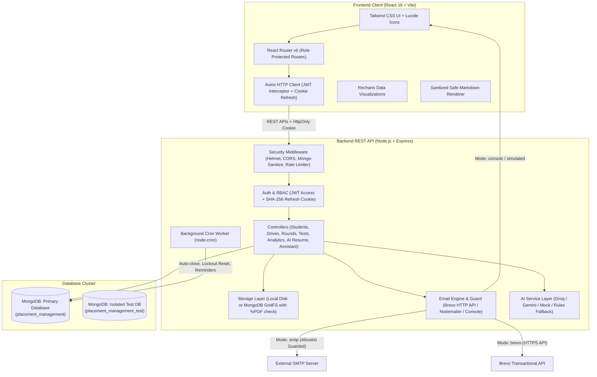
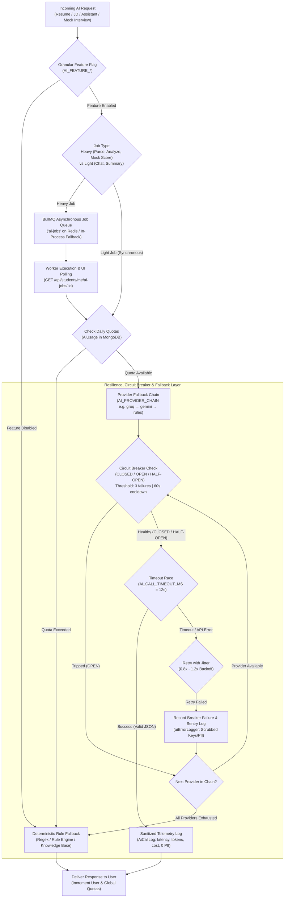

# Campus Placement & Recruitment Management System

[](https://github.com/Krunalsinh27/ai-placement-platform/actions/workflows/ci.yml)

A modern, multi-tenant higher education recruitment platform connecting colleges, engineering and management students, recruiting corporations, independent accreditation analysts, and prospective students into a unified campus hiring lifecycle. The system provides secure role-based portals for publishing job requirements, submitting institutional drive requests, managing multi-stage selection pipelines (automated batching, timed aptitude tests with real-time autosave and tab-switch detection, interview slot booking, and attendance tracking), extending formal offers, providing AI-assisted resume parsing with a rule-based fallback (with deterministic ATS-readiness scoring) & explainable applicant matching, and benchmarking institutional placement records with small-group suppression (k-anonymity, k=5) protections.

> **Synthetic Data Notice**: All demonstration accounts, institutional profiles, student names, and employer data seeded in this repository are entirely synthetic and generated strictly for evaluation, testing, and demonstration purposes.

---

## Architecture & System Overview



---

## User Roles & Capabilities

| Role | Key Capabilities & Permissions |
|---|---|
| **`student`** | Complete academic profile (branch, CGPA, backlogs, skills), upload verified PDF resume, parse skills & estimate ATS score with Resume AI, align resume against campus drives or pasted job descriptions, explore eligible on-campus drives, apply for drives, take timed on-platform aptitude tests, join live interview rooms, track candidate pipeline timelines, accept/decline offers, and ask the role-aware assistant. |
| **`tpo`** | Training & Placement Officer. Manage college student rosters, approve pending colleague TPOs and newly registered students, review recruiter drive requests, schedule on-campus drives, freeze applicant lists, run auto-batching, track attendance, inspect explainable applicant matches with AI ranking, export placement reports to Excel/CSV, and run natural language queries with the TPO assistant. |
| **`admin`** | Institutional placement director. Manages institutional settings (such as student auto-approval toggles), oversees college-wide placement statistics, and controls local college operations. |
| **`recruiter`** | Corporate talent acquisition. Register company profile, post hiring requirements, submit campus drive requests to partner institutions, configure evaluation rounds (platform tests, external links, offline interviews), manage interview panels & candidate queue slots, view ranked applicants with explainable skill match scores, extend bulk job offers, and consult the recruiter assistant. |
| **`superadmin`** | Root platform administrator. Approves/rejects new educational institutions, verifies corporate employer accounts, authorizes observer analysts, and exercises platform-wide account approval overrides. |
| **`analyst`** | Independent observers and researchers. Explore cross-institutional placement analytics, track average/median/highest package distributions, compare up to 3 colleges, and export small-group suppressed data to PDF or Excel. |
| **`aspirant`** | Prospective students and parents. Explore verified colleges, filter by all 36 Indian states and UTs, review transparent branch placement rates, and receive personalized recommendations based on home state and preferred disciplines. |

---

## End-to-End Recruitment Pipeline Flow

```mermaid
sequenceDiagram
    autonumber
    actor Recruiter as Recruiter
    actor TPO as College TPO
    actor Student as Student
    participant Platform as Platform Engine
    participant Email as Email Service / Guard

    Recruiter->>TPO: Submit Drive Request (Job Requirement, Salary, Eligibility)
    TPO->>Platform: Accept Proposal & Schedule Live Drive
    Platform->>Student: In-App Notification & Drive Listed in Eligible Drives
    Student->>Platform: Submit Application (Real-Time Skill Match Calculated)
    TPO->>Platform: Freeze Candidate List (Close Applications & Seed Round 1)
    Platform->>Platform: Auto-generate Selection Rounds & Auto-split Batches
    Platform-->>Email: Dispatch Round Batch Schedules to Students
    Note over Student,Platform: Round 1: Online Aptitude Assessment
    Student->>Platform: Take Timed Aptitude Test (Autosave, Tab-Switch Alert, Auto-Submit)
    Recruiter->>Platform: Publish Cutoff & Shortlist Candidates
    Platform->>Platform: Advance Cleared Candidates to Round 2
    Note over Recruiter,Platform: Round 2: Technical Interview Slot Booking
    Recruiter->>Platform: Configure Interview Panels & Candidate Queue Slots
    Platform->>Student: Slot Allocated; Join Queue in Candidate Interview Room
    Platform-->>Email: Interview Reminder (24h prior)
    Note over Recruiter,Platform: Final Selection & Job Offers
    Recruiter->>Platform: Extend Bulk Offers (Package LPA, Acceptance Deadline)
    Platform->>Student: Offer Notification & Timeline Updated
    Student->>Platform: Accept & Confirm Placement Offer (or Decline)
    Platform->>Platform: Record Official Placement & Update Application to "Selected"
    Platform-->>Email: Placement Confirmation Dispatched to Student & Recruiter
```

---

## Key Features

### 1. Multi-Stage Recruitment Pipeline
- Customizable round stages (Aptitude Assessment, Coding, Technical Interview, HR Interview, Group Discussion).
- Multi-delivery modes: on-platform test, external meeting links (Google Meet / Zoom / MS Teams), and offline on-campus venues.
- Intelligent batch auto-splitting in enrollment order with conflict and institutional venue clash detection.
- Stage progression controls with applicant freeze (`Close Applications & Freeze List`), candidate shortlisting, and re-test authorization.

### 2. On-Platform Aptitude Engine
- **Timed Attempts**: Strict server-enforced assessment durations and deadlines with real-time countdown clocks.
- **Real-Time Autosave**: Every question response is asynchronously persisted to the server immediately upon selection.
- **Tab-Switch Detection**: Window blur and tab-switching events are monitored, logged, and surfaced to recruiters as security alerts.
- **Question Palette Navigation**: Seamlessly review answered, unattempted, and flagged questions.
- **Question Bank Import**: CSV question bank import with automated category, question, options, and negative marking validation.
- **Auto-Submission**: Background cron worker automatically concludes and grades attempts upon test window expiration.
*(Note: The engine provides structured examination mechanics and client-side event detection; it does not provide AI webcam or biometric proctoring).*

### 3. Resume AI & Target Job Analyzer
- **Skill Extraction & Normalization**: PDF resume parsing (max 5MB, `%PDF` magic byte verification) with AI-assisted parsing and rule-based fallback; the ATS score itself is deterministic. Technical proficiencies, education, experience, and projects are extracted, with skills normalized (lowercase, alphanumeric + `# . - /`, max 40 chars) and categorized into Languages, Frontend, Backend, Databases, Tools & Platforms, Concepts, and CS Fundamentals.
- **Privacy & PII Stripping**: Personal identifiable information (phone numbers, emails, national identity numbers, external URLs) is stripped before any text is transmitted to an LLM provider.
- **Deterministic ATS-Readiness Scoring (0-100)**: Computed deterministically across 7 weighted categories summing strictly to 100 points:
  - *Keywords & Semantic Evidence Match (35 pts)*: Required proficiencies (25 pts) and preferred proficiencies (10 pts), weighted by evidence depth (1.0 for projects/experience vs 0.7 for list-only mentions) and semantic similarity with embedding clusters. Unknown skills are preserved, and single-category targets scale proportionally up to 35 pts.
  - *Years of Experience Fit (10 pts)*: Evaluates candidate experience duration against target minimum years (10/10 if candidate meets or exceeds requirement, scaled proportionally if below, or 10/10 if entry-level/unspecified).
  - *Education Fit (5 pts)*: Aligns candidate degree level (B.Tech, M.Tech, MCA, BCA, Bachelor's, Master's) against target requirements (5/5 for direct degree match or unspecified requirement, 3/5 for related degree).
  - *Resume Structure (15 pts)*: Standard section presence (contact details: 4 pts, education: 3 pts, skills: 4 pts, projects/experience: 4 pts).
  - *Quantifiable Impact & Scale (15 pts)*: Bullet-level impact detected with hardened metrics regex (% improvements, multipliers like 2x, currency, scale terms like users/requests/clusters, and time saved; bare counts like "3 projects" or graduation years are rejected).
  - *Action Verbs Usage (10 pts)*: Direct, decisive action verbs initiating project and experience bullet points.
  - *Formatting, Length & Density (10 pts)*: Machine-parseable text (3 pts), sensible length (150–1200 words, 4 pts), and clean line density (3 pts).
- **OCR Fallback for Scanned Resumes**: When text extraction returns fewer than 20 characters from a PDF (e.g. image-only or scanned PDF), multimodal OCR fallback is triggered automatically to recover resume text, preserving the 5MB file size limit and %PDF magic byte validation.
- **Target Job Alignment**: Aligns resume profiles against either an active campus placement drive or an arbitrary pasted job description (up to 8,000 characters) with LLM and rule-based section and requirement extraction.
- **Missing Skills Identification**: Surfaces missing required and preferred proficiencies needed for the role.
- **Actionable Bullet Rewrites**: AI-generated bullet recommendations using the XYZ / STAR format with highlighted bracketed metric placeholders (`[add your real number]`, `[metric]`), paired with clear warnings advising candidates to insert real figures and keep truthful claims only.
- **Instant Hash Caching**: SHA-256 content hashing of resume text and target job descriptions returns instant cached scores on duplicate requests, consuming zero quota.

### 4. Explainable AI Applicant Matching
- **Deterministic Candidate Ranking (0-100%)**: Ranks drive applicants deterministically based on skill alignment, academic eligibility (CGPA, backlogs, branch, college tenancy), and verified project/work experience evidence.
- **Demographic Neutrality**: Protected demographic attributes (name, gender, religion, category, photo, college name) are strictly excluded from ranking formulas and scoring algorithms.
- **Explainable Match Breakdown**: "AI Explanation" modal providing a transparent, auditable breakdown of matched skills, verified evidence, missing skills, and eligibility status.
- **Transparent Drive Baselines**: Drives with no listed skill requirements display "No skill requirements listed" with a null score rather than receiving an unearned 100%.

### 5. Multi-Role Analytics & Placement Assistant ("Ask AI")
- **Strict Intent Routing**: The LLM functions exclusively as an intent router mapping user questions to a strict whitelist of `{ tool, params }` using Zod schemas tailored to the caller's role (Student, Recruiter, TPO, Superadmin).
- **Zero Database Querying by LLM**: The LLM **never** writes or executes database queries. All data operations are handled by pre-written, tested server functions scoped strictly to the authenticated user's session tenant (college for TPOs, company for Recruiters, student profile for Students).
- **Prompt Injection Defense**: User questions are capped at 300 characters, wrapped in delimited `<USER_QUESTION>` data blocks, with system prompt directives enforcing that input is data, not instructions.
- **Curated Help Knowledge Base**: Pre-written step-by-step guides for real platform workflows. Curated queries are intercepted deterministically to consume zero LLM tokens and zero chat quota.
- **Bounded Career Advisor**: Strictly bounded second LLM completion for technical career advice, interview preparation (e.g. STAR method), and study roadmaps under 150 words with no URLs and no platform/college claims.
- **Sanitized Safe Markdown Chat UI**: Custom React renderer (`SafeMarkdown.jsx`) parsing headings, bold, ordered/bullet lists, and code spans without `dangerouslySetInnerHTML`, while treating links as unclickable plain text to prevent script execution.

### 6. Privacy-Preserving Institutional Analytics
- **Small-Group Suppression (k-Anonymity, k=5)**: Metric cohorts with fewer than 5 students are masked (`< 5 (k-anonymity, k=5)`) to protect individual candidate privacy and prevent re-identification across all aggregate queries.
- **Cross-College Benchmarking**: Comparison matrix with salary percentiles (average, median, top 10%).
- **Multi-Format Executive Exports**: Multi-sheet Excel workbooks (`exceljs`) and publication-ready PDF reports (`pdfkit`).

### 7. Prospective Student (Aspirant) Intelligence
- Transparent placement statistics for pre-admission discovery across all 36 Indian States and Union Territories.
- Recommendation ranking engine weighted by discipline-specific placement rates and home-state tie-breaking.

### 8. Robust Multi-Tenancy & Access Scoping
- Complete institutional data isolation: TPOs and Admins are restricted strictly to their assigned college tenant.
- Recruiters are scoped strictly to their corporate entity and confirmed drives.
- Students access only their own applications, interview slots, and confirmed offers.

### 9. Hardened Communication & Email Queue
- In-memory asynchronous queue worker with exponential retry backoff (`1s`, `5s`, `30s`) and permanent 5xx failure skipping.
- Comprehensive safety guard with test simulation logging, fake domain rejection, and sliding-window rate capping.

---

## AI Providers & Production Resiliency Architecture



### Production AI Resilience Features
1. **Multi-Provider Fallback Chain**: Configurable failover sequence (`AI_PROVIDER_CHAIN`, default `groq,gemini,rules`). If the primary provider experiences transient downtime, rate limiting, or malformed outputs, requests seamlessly cascade to secondary providers before defaulting to the zero-downtime rule-based engine.
2. **Three-State Circuit Breaker**: Tracks provider failure states (`CLOSED`, `OPEN`, `HALF-OPEN`). If a provider accumulates 3 consecutive failures, it trips to `OPEN` for 60 seconds to prevent resource exhaustion and timeout cascades, automatically probing with a single trial request in `HALF-OPEN` mode.
3. **Strict Timeouts & Jittered Backoff**: Every provider call races against a strict timeout (`AI_CALL_TIMEOUT_MS`, default 12,000 ms). Retries employ exponential backoff with randomized full jitter ($0.8\times - 1.2\times$) to prevent thundering herd spikes.
4. **Asynchronous Heavy Job Processing (BullMQ)**: Resource-intensive operations (PDF resume parsing, ATS job analysis, mock interview scoring) are dispatched to BullMQ background queues with Redis backing (and automatic in-process fallback in local dev/test). The frontend polls status every 1.5 seconds, eliminating HTTP timeout vulnerabilities.
5. **Sanitized Telemetry Logging (`AiCallLog`)**: Logs operational latency, token counts, cost estimations, and failure reasons with automated 30-day TTL indexing. **Strictly zero PII, zero student names, and zero raw resume text are ever logged.**
6. **Sentry Error Tracking**: Scrubbed error hooks (`aiErrorLogger.js`) capture provider stack traces while proactively stripping API keys, bearer tokens, passwords, and sensitive student metadata.
7. **Granular Feature Flags**: Every AI capability can be individually enabled or disabled via environment variables (`AI_FEATURE_*`) without restarting or redeploying the platform.
8. **Superadmin AI Observability Dashboard**: Real-time operational dashboard for root administrators displaying total daily AI invocations, estimated API expenditure, provider fallback rates, circuit breaker health, failure breakdowns, and average latency per feature.

### Daily Usage Quotas & Caps
All AI operations are governed by daily sliding-window caps persisted in MongoDB (`AiUsage` model) keyed by `YYYY-MM-DD`:
- **Global Daily Cap (`AI_DAILY_CALL_CAP`, default 400)**: Total AI provider calls allowed across all tenants and users combined.
- **User Parse Cap (`AI_USER_DAILY_PARSE_CAP`, default 5)**: Daily resume parsing attempts per candidate.
- **User Analyze Cap (`AI_USER_DAILY_ANALYZE_CAP`, default 10)**: Daily ATS target job analyses per candidate.
- **User Chat Cap (`AI_USER_DAILY_CHAT_CAP`, default 30)**: Daily assistant interactions per user. Curated help queries consume 0 quota.
- **User Mock Interview Cap (`AI_USER_DAILY_MOCK_CAP`, default 5)**: Daily mock interview sessions per candidate.
- **User Resume Builder Cap (`AI_USER_DAILY_BUILDER_CAP`, default 10)**: Daily resume tailoring and cover letter generations per candidate.

---

## Tech Stack

| Layer | Technologies |
|---|---|
| **Frontend** | React 18, Vite, React Router v6, Tailwind CSS, Lucide React, Recharts, React Hot Toast, Axios |
| **Backend** | Node.js, Express.js (CommonJS), Mongoose ODM, JSON Web Tokens, Bcrypt.js, Cookie-Parser, Zod |
| **AI & NLP** | Groq SDK, Google Gemini REST API, Custom Resiliency Retry Wrapper, PDF-Parse, Mammoth |
| **Security & Hardening** | Helmet, Express Mongo Sanitize, Express Rate Limit, Multer (%PDF magic bytes), CORS |
| **Reporting & Documents** | PDFKit, ExcelJS, CSV Parser |
| **Task Scheduling & Email** | Node-Cron, Nodemailer, Brevo HTTP API (with custom delivery guard & queue worker) |
| **Database** | MongoDB 7.0+ (Indexes, Compound Indexes, Unique Constraints, GridFS) |
| **Testing & CI** | Custom Node.js Test Harness (19 suites), GitHub Actions (Ubuntu, Node 20, MongoDB service container) |

---

## Setup & Installation

### Prerequisites
- **Node.js**: v18.0.0 or higher (v20+ recommended)
- **MongoDB**: v6.0 or higher running locally on `localhost:27017` or a cloud MongoDB Atlas URI
- **Git**

### 1. Clone Repository & Install Dependencies
```bash
# Clone the repository
git clone https://github.com/Krunalsinh27/ai-placement-platform.git
cd ai-placement-platform

# Install server dependencies
cd server
npm install

# Install client dependencies
cd ../client
npm install
cd ..
```

### 2. Environment Variables Configuration

Copy `.env.example` templates to `.env` in both `/server` and `/client`:

```bash
cp server/.env.example server/.env
cp client/.env.example client/.env
```

#### Core Server Configuration (`server/.env`):
| Variable | Required | Default / Example Value | Description |
|---|---|---|---|
| `PORT` | Optional | `5000` | Backend API port |
| `NODE_ENV` | Optional | `development` | Runtime environment (`development`, `production`, `test`) |
| `CLIENT_URL` | Optional | `http://localhost:5173` | Allowed CORS origin |
| `FRONTEND_URL` | Optional | `http://localhost:5173` | Frontend URL for email verification links |
| `MONGO_URI` | **Required** | `mongodb://127.0.0.1:27017/placement_management` | Main MongoDB connection URI |
| `MONGO_URI_TEST` | Optional | `mongodb://127.0.0.1:27017/placement_management_test` | Isolated database used for automated tests |
| `REDIS_URL` | **Required in Prod** | `redis://127.0.0.1:6379` | Redis connection URL (supports TLS `rediss://`). Powers BullMQ queues, rate limits, and cron schedulers. In dev/test, falls back to in-process memory queue when unset |
| `RUN_WORKER_IN_API` | Optional | `true` | When true (default), runs BullMQ queue workers & cron scheduler in the API process. Set to false if running workers in `node worker.js` |
| `HEALTH_DETAIL_KEY` | Optional | `secret_health_token` | Optional secret key. When provided via request header `x-health-key`, `GET /api/health` exposes detailed BullMQ queue depths |
| `JWT_SECRET` | **Required** | `your_secure_random_key_min_32_characters_long` | Secret for signing JWT access tokens (must be >= 32 chars) |
| `JWT_REFRESH_SECRET` | **Required** | `your_secure_refresh_key_min_32_characters_long` | Secret for signing refresh tokens |
| `COOKIE_SAME_SITE` | Optional | `lax` | SameSite cookie policy (`lax`, `strict`, `none`) |
| `STORAGE_DRIVER` | Optional | `local` | `local` (disk) or `gridfs` (MongoDB Atlas GridFS) |
| `BLOCK_PLACED_STUDENTS` | Optional | `false` | When true, prevents placed students from applying to new drives |
| `DEMO_SHOW_OTP` | Optional | `false` | Displays OTP on verify page in dev mode (blocked in production) |

#### Email Service Configuration (`server/.env`):
| Variable | Required | Default / Example Value | Description |
|---|---|---|---|
| `EMAIL_MODE` | Optional | `console` | `smtp`, `brevo`, or `console` (forces simulated console printing) |
| `EMAIL_PROVIDER` | Optional | `smtp` | `smtp` or `brevo` (HTTPS API without external SDK) |
| `BREVO_API_KEY` | Optional | `xkeysib-...` | Brevo HTTP API key (used when `EMAIL_PROVIDER=brevo`) |
| `BREVO_SENDER_EMAIL` | Optional | `noreply@placementportal.edu` | Verified Brevo sender email address |
| `BREVO_SENDER_NAME` | Optional | `Placement Portal` | Sender display name for Brevo |
| `SMTP_HOST` | Optional | `smtp.gmail.com` | SMTP relay server host |
| `SMTP_PORT` | Optional | `587` | SMTP port (587 for STARTTLS, 465 for SSL) |
| `SMTP_SECURE` | Optional | `false` | `true` for SSL (port 465), `false` for STARTTLS (587) |
| `SMTP_USER` | Optional | `your-email@gmail.com` | SMTP username / address |
| `SMTP_PASS` | Optional | `xxxx xxxx xxxx xxxx` | SMTP app password |
| `MAIL_FROM` | Optional | `"Placement Portal" <noreply@portal.com>` | Outgoing sender header |
| `EMAIL_DEV_ALLOWLIST` | Optional | `dev@example.com` | Comma-separated addresses permitted in dev SMTP |
| `EMAIL_MAX_PER_MINUTE` | Optional | `20` | Sliding window rate cap on SMTP dispatches |

#### AI Service, Resilience & Quota Configuration (`server/.env`):
| Variable | Required | Default / Example Value | Description |
|---|---|---|---|
| `AI_PROVIDER` | Optional | `none` | Active primary provider: `groq`, `gemini`, `mock`, or `none`. (`mock` is forbidden in production). |
| `AI_PROVIDER_CHAIN` | Optional | `groq,gemini,rules` | Ordered failover chain across providers with automated circuit breaking and timeout handling. |
| `AI_CALL_TIMEOUT_MS` | Optional | `12000` | Per-call timeout threshold (milliseconds) before aborting and failing over. |
| `SENTRY_DSN` | Optional | `https://...@sentry.io/...` | Optional Sentry DSN for capturing sanitized AI exceptions (PII and API keys stripped). |
| `AI_API_KEY` | Conditional | `gsk_...` / `AIza...` | API key for Groq or Gemini (required if using external AI providers). |
| `AI_MODEL` | Optional | `llama-3.3-70b-versatile` | Primary model name for resume parsing, analysis, and advisor completions. |
| `AI_MODEL_FAST` | Optional | `llama-3.1-8b-instant` | Fast model for assistant intent routing (falls back to `AI_MODEL`). |
| `AI_DAILY_CALL_CAP` | Optional | `400` | Global daily AI call cap persisted in MongoDB across all tenants. |
| `AI_USER_DAILY_PARSE_CAP` | Optional | `5` | Daily resume parsing cap per candidate. |
| `AI_USER_DAILY_ANALYZE_CAP` | Optional | `10` | Daily resume ATS job analysis cap per candidate (separate from parsing). |
| `AI_USER_DAILY_CHAT_CAP` | Optional | `30` | Daily assistant chat cap per user (separate from parsing and analyze caps). |
| `AI_USER_DAILY_MOCK_CAP` | Optional | `5` | Daily mock interview attempts per candidate. |
| `AI_USER_DAILY_BUILDER_CAP`| Optional | `10` | Daily resume builder & tailoring generations per candidate. |
| `AI_FEATURE_RESUME_PARSE` | Optional | `true` | Feature flag toggle for AI resume parsing. |
| `AI_FEATURE_RESUME_ANALYZE`| Optional | `true` | Feature flag toggle for ATS job description analysis. |
| `AI_FEATURE_ASSISTANT` | Optional | `true` | Feature flag toggle for Multi-Role Ask AI assistant. |
| `AI_FEATURE_MOCK_INTERVIEW`| Optional | `true` | Feature flag toggle for Student Mock Interview simulation. |
| `AI_FEATURE_RESUME_BUILDER`| Optional | `true` | Feature flag toggle for AI Resume Builder & Tailoring. |
| `AI_FEATURE_RECOMMENDATIONS`| Optional | `true` | Feature flag toggle for Smart Drive Recommendations. |
| `AI_FEATURE_SKILL_GAP` | Optional | `true` | Feature flag toggle for Weekly Skill-Gap Learning Plans. |
| `AI_FEATURE_TPO_INSIGHTS` | Optional | `true` | Feature flag toggle for At-Risk Student Lists & TPO Insights. |

#### Client Configuration (`client/.env`):
| Variable | Required | Default Value | Description |
|---|---|---|---|
| `VITE_API_BASE_URL` | Optional | `http://localhost:5000/api` | Base URL pointing to Express backend |

#### Redis & Background Queues Configuration:
- **Production Requirement**: `REDIS_URL` is required in production (`NODE_ENV=production`). Startup validation will fail fast if it is missing.
- **Development & Test Fallback**: In development and test, if `REDIS_URL` is omitted, the platform falls back to in-process memory queues, in-memory rate limiting, and `node-cron`, allowing the entire test suite to run without Redis.
- **Free-Tier Sleeping Behavior**: On sleeping free instances (such as Render free tier), the process pauses during sleep, halting background queues and scheduled cron jobs until incoming traffic wakes the server. Ping `/api/health` every 10 minutes to maintain persistent uptime.
- **Running Local Redis for Durability Testing**:
  - **Docker**: `docker run -d --name redis-test -p 6379:6379 redis:alpine`
  - **WSL / Linux**: `sudo apt update && sudo apt install redis-server && sudo service redis-server start`
  - Set `REDIS_URL=redis://127.0.0.1:6379` in `server/.env` to enable durable BullMQ queues and run the live Redis test suite.

### 3. Seed Database
Populate the database with synthetic colleges, companies, recruiters, TPOs, students, applications, and placement metrics:
```bash
cd server
npm run seed
```

### 4. Run the Development Servers

Start the backend API server:
```bash
# In /server terminal
npm run dev
# Server starts on http://localhost:5000
```

Start the Vite frontend development server:
```bash
# In /client terminal
npm run dev
# Frontend starts on http://localhost:5173
```

---

## Known Limitations & Boundaries

### 1. Platform Infrastructure Limitations
1. **Development Seed Credentials**: All demonstration accounts (`superadmin@portal.com`, `admin@college.com`, etc.) exist exclusively in non-production development seeds. When `NODE_ENV=production`, seeding scripts strictly refuse to create demo accounts. Production superadmin accounts must be provisioned via `npm run seed:superadmin`.
2. **Aptitude Test Proctoring**: The on-platform assessment engine provides timed attempts with server-enforced countdown deadlines, real-time autosave, question palette navigation, and client-side tab-switch detection and event logging. It does **not** provide automated biometric, webcam, or audio/video AI proctoring.
3. **Small-Group Privacy Suppression (k-Anonymity, k=5)**: In aggregate analytics and public benchmarks, cohort groups with fewer than 5 matching candidates are masked (`lt5`) to protect student identities and prevent re-identification.
4. **Resume File Support**: Resume uploads are strictly restricted to PDF documents under 5MB, validated via `%PDF` magic byte header checks.
5. **Render Free Tier Spin-Down**: On free-tier hosting without persistent background processes, in-process cron jobs pause during inactivity sleep unless an external keep-alive ping (`GET /api/health`) is configured.

### 2. AI System Boundaries & Limitations
1. **Deterministic vs. Generative Separation**: All candidate evaluations, ATS readiness scores (0-100), applicant ranking, drive eligibility checks, and at-risk student flags are **100% deterministic algorithms** ($\sigma^2 \equiv 0$). Generative LLMs are strictly prohibited from generating numeric candidate scores or ranking applicants. LLM usage is constrained to text extraction, semantic paraphrasing, mock interview feedback, and intent routing.
2. **Truthfulness & Anti-Hallucination Guarantees**:
   - In AI Resume Tailoring, the system strictly forbids the LLM from inventing employers, technical skills, dates, or quantitative metrics.
   - Any suggested metric must use bracketed placeholders (`[add your real number]`), and the UI blocks PDF export until placeholders are replaced with genuine candidate accomplishments.
   - In Skill-Gap Learning Plans, the AI is constrained to curated allowlisted resources or generic resource types; it is prohibited from fabricating non-existent web URLs.
3. **Multimodal OCR Limits**: Scanned or rasterized PDF resumes with fewer than 20 characters automatically fall back to multimodal OCR. However, low-DPI scans (< 150 DPI), skewed smartphone photos, or heavily degraded documents may experience diminished extraction recall.
4. **Token Context & Input Length Bounds**: To prevent Denial of Service (DoS) and context window exhaustion, user inputs are strictly bounded:
   - Assistant queries: Capped at 1,500 characters.
   - Pasted Job Descriptions: Capped at 8,000 characters.
   - Resume PDFs: Capped at 5MB with strict `%PDF` header validation.
   - Assistant memory: Sliding window of the last 10 messages with automatic summarization of older dialogue history.
5. **Strict Data Tenancy Isolation**: The assistant operates on pre-defined server-side tools where the calling user's tenant ID (college for TPO, corporate entity for Recruiter, student ID for Student) is injected strictly from the authenticated JWT session. The LLM has zero direct SQL/MongoDB access and cannot retrieve data across tenant boundaries regardless of prompt framing or adversarial jailbreak attempts.
6. **PII Redaction & Sanitization**: Prior to transmitting resumes, job descriptions, or user queries to external LLM providers (Groq/Gemini), personal identifiers (phone numbers, personal emails, national IDs, external URLs) are scrubbed. Telemetry logs (`AiCallLog`) store strictly zero PII and zero raw resume text.
7. **Demographic Neutrality**: Scoring, matching, and recommendation algorithms strictly exclude protected demographic attributes (name, gender, religion, caste/category, photo, and college name) to prevent algorithmic bias.

---

## Development Email Guard Behavior

To prevent accidental spamming or inbox flooding during local development and testing, the platform features a centralized delivery guard in `server/utils/emailService.js`:

1. **Console Simulation Mode (`EMAIL_MODE=console`)**:
   - Outgoing emails are intercepted, formatted cleanly, and printed directly to the terminal stdout.
   - OTP codes are rendered in a visible simulation box for immediate copy-pasting.
2. **Real SMTP Guard (`EMAIL_MODE=smtp`)**:
   - Real email dispatch is allowed **only if ALL of the following conditions are met**:
     - `EMAIL_MODE === 'smtp'` and SMTP credentials are fully configured.
     - `NODE_ENV !== 'test'` (automated tests never send real emails).
     - The recipient domain is **NOT** in the blocked domain blacklist (`portal.com`, `college.com`, `example.com`, etc.).
     - Either `NODE_ENV === 'production'` OR the recipient email is explicitly present in the comma-separated `EMAIL_DEV_ALLOWLIST` environment variable.
3. **Permanent Failure Handling**:
   - Permanent SMTP errors (HTTP 5xx status codes, "user unknown", "mailbox not found") are detected immediately and marked failed with 0 retries, preventing endless queue retry loops.
4. **Rate Capping**:
   - Outgoing dispatches are throttled by `EMAIL_MAX_PER_MINUTE` (default 20/min) using an in-memory sliding window.

---

## Automated Testing & CI

### Running the Test Suite
The backend contains 19 automated test suites that run sequentially against an isolated test database (`placement_management_test`).

```bash
# Run all 19 automated test suites sequentially
cd server
npm run test:all

# Or drop the test database fresh before running
npm run test:fresh
```

#### Individual Test Suites:
```bash
npm run test:datetime     # IST date-time parsing and timezone neutrality
npm run test:emailguard   # Email guard, blocked domains, allowlist, rate limits
npm run test:auth         # Password rules, OTP flows, lockout, student approval
npm run test:colleges     # College lifecycle, multi-tenant isolation, TPO scoping
npm run test:notifications# Notification events, drive alerts, applicant triggers
npm run test:pipeline     # Drive freeze, selection rounds, batch split, attendance
npm run test:interviews   # Panel scheduling, unique links, candidate slot booking
npm run test:emails       # HTML templates, queue worker retries, cron reminders
npm run test:delivery     # Delivery modes (online/link/offline), attendance PDFs
npm run test:aptitude     # Aptitude question bank, timed attempts, auto-submit
npm run test:analyst      # Analyst RBAC, small-group suppression (<5), analytics exports
npm run test:superadmin   # Platform overview, account approvals, public directory
npm run test:aspirant     # Aspirant preferences, recommendations, 36-state filter
npm run test:storage      # Storage driver abstraction (local disk vs GridFS)
npm run test:deploy       # Deployment configuration, render.yaml, and env integrity
npm run test:prodguard    # Production safety guards and forbidden mock provider checks
npm run test:reports      # Report generation, formula injection safety, Excel/CSV exports
npm run test:ai           # Resume parsing, ATS scoring, JD matching, quotas, PII stripping
npm run test:assistant    # Multi-role Ask AI assistant, tool scoping, zero-quota help topics
npm run test:mockinterview# AI Mock interview, rubric evaluation, STAR format, session teardown
npm run test:resumebuilder# Resume builder templates, ATS check, anti-hallucination, cover letter
npm run test:smartanalytics# Smart drive ranking, skill-gap learning plans, explainable at-risk TPO insights
npm run test:redteam      # Red-team adversarial attacks (prompt injection, cross-tenant leaks, breaker)
npm run ai:eval           # Labeled AI evaluation harness: Skill extraction F1, ATS invariance, 200 routing questions
```

#### Manual Verification Scripts (with running server):
```bash
# Test all live role logins and paginated endpoints
node tests/verifyLiveServerAndClient.js

# Test security hardening (resume RBAC, recruiter approval, token refresh)
node tests/verifySecurityHardening.js
```

### Continuous Integration (CI)
GitHub Actions workflow is located at `.github/workflows/ci.yml`. On every push and pull request to `main` or feature branches, the pipeline:
- Spins up a `mongo:7.0` health-checked service container on port `27017`.
- Sets up Node.js 20 with package-lock caching.
- Executes `npm ci` and runs `npm run test:all` in `/server`.
- Executes `npm ci` and verifies production bundle build via `npm run build` in `/client`.

---

## Development Credentials & Account Provisioning

> [!IMPORTANT]
> Demonstration accounts are for **development only and are never created in production**. In production (`NODE_ENV=production`), database seeding scripts refuse to run with published demo passwords and require environment-provided credentials or one-time auto-generated keys.

To provision development accounts with sample colleges, drives, applicants, and pipeline data, run:
```bash
npm run seed
```
The seed command outputs the assigned accounts and temporary development credentials directly to the terminal console.

| Role | Default Email Address | Password Source | Details / Assigned Organization |
|---|---|---|---|
| **Superadmin** | `superadmin@portal.com` (or `$SUPERADMIN_EMAIL`) | `npm run seed:superadmin` console output / `$SUPERADMIN_PASSWORD` | Platform Root Administrator |
| **College TPO / Admin** | `admin@college.com` | `npm run seed` terminal output / `$ADMIN_PASSWORD` | National Institute of Technology Delhi (NITD) |
| **College TPO** | `tpo.pict@college.com` | `npm run seed` terminal output | Pune Institute of Computer Technology (PICT) |
| **Recruiter** | `recruiter@google.com` | `npm run seed` terminal output | Google Campus Talent Partner |
| **Student** | `aarav.sharma1@college.com` | `npm run seed` terminal output | NIT Delhi - CSE (Final Year) |
| **Analyst / Observer** | `analyst@portal.com` | `npm run seed` terminal output | Higher Education Analytics Board |
| **Aspirant** | `aspirant@portal.com` | `npm run seed` terminal output | Prospective Student (State: Delhi) |

---

### Cookie & Cross-Site Authentication Architectures

The platform supports two deployment architectures for JWT access tokens and `httpOnly` refresh tokens:

1. **Cross-Site Decoupled Mode** *(Default for Vercel + Render)*:
   - Frontend: `https://campus-placement.vercel.app`
   - Backend API: `https://campus-placement-api.onrender.com`
   - Settings:
     - `COOKIE_SAMESITE=none`
     - `COOKIE_SECURE=true`
     - `COOKIE_DOMAIN` unset (host-only cookie on the Render origin)
     - `CLIENT_URL=https://campus-placement.vercel.app` (strictly validated without wildcards)
   - Behavior: Modern browsers transmit the cross-site `httpOnly` cookie via `withCredentials: true` with strict CSRF header enforcement (`X-Requested-With: XMLHttpRequest`).

2. **Shared-Site Same-Domain Mode** *(e.g. Custom Corporate / University Domain)*:
   - Frontend: `https://app.example.com`
   - Backend API: `https://api.example.com`
   - Settings:
     - `COOKIE_DOMAIN=.example.com` (or `example.com`)
     - `COOKIE_SAMESITE=lax`
     - `COOKIE_SECURE=true`
     - `CLIENT_URL=https://app.example.com`
   - Behavior: Cookies are shared across subdomains under `.example.com` using first-party `SameSite=Lax`, offering maximum privacy protection and compatibility with all browser third-party cookie restrictions.

---

## Production Deployment & Cloud Architecture

The platform is designed for turnkey cloud deployment with zero additional cloud storage dependencies:

- **Frontend Client**: Hosted on [Vercel](https://vercel.com) as a single-page application configured with `client/vercel.json` for React Router deep linking.
- **Backend API**: Hosted on [Render](https://render.com) using the root Blueprint definition `render.yaml`.
- **Database & Object Storage**: Hosted on [MongoDB Atlas](https://www.mongodb.com/atlas). Resumes are stored directly in Atlas using MongoDB GridFS (`STORAGE_DRIVER=gridfs`), avoiding external S3 buckets while surviving Render's ephemeral filesystem redeploys.
- **Transactional Email**: Supported via Brevo HTTPS API (`EMAIL_PROVIDER=brevo`) or standard SMTP (`EMAIL_PROVIDER=smtp`), fully guarded against test recipient bounces and domain flooding.
- **Initial Setup**: Run `npm run seed:superadmin` to safely provision the first platform superadmin without demo data.
- **Health Check & Keep-Alive**: The API exposes `GET /api/health` returning `{ status: "ok", db: "connected" }`.
  > [!NOTE]
  > **Render Free Tier & In-Process Cron Jobs**: Render free tier instances spin down after 15 minutes of inactivity. When asleep, in-process timers and `node-cron` schedules (such as interview reminders and application auto-closing) pause until the next incoming request wakes the instance. To keep scheduled jobs running on time without upgrading to a paid instance, configure an external uptime monitor (e.g. [UptimeRobot](https://uptimerobot.com) or [Cron-Job.org](https://cron-job.org)) to ping `GET /api/health` every 10 minutes.

For comprehensive, step-by-step instructions on deploying MongoDB Atlas, Render, and Vercel, refer to [DEPLOY.md](DEPLOY.md).

---

## Security & Hardening Measures

- **Recruiter & Corporate Approval**: Newly registered recruiters default to `isApproved: false` and their companies default to `verified: false`. Superadmins review credentials in a dedicated verification dashboard prior to allowing drive creation.
- **Resume Access Control & IDOR Prevention**: Static file serving for resume uploads is disabled. Resumes are streamed via an authenticated route (`GET /api/students/:studentId/resume`) enforcing multi-tenant authorization (student owner, same-college TPO, recruiter with active application, superadmin). Direct upload requests validate `%PDF` magic byte headers.
- **Short-Lived Tokens & Refresh Rotation**: Access tokens expire in 15 minutes. Long-lived refresh tokens (7 days) are transmitted in `httpOnly`, `sameSite` secure cookies. Refresh token hashes (SHA-256) are stored in MongoDB and revoked on logout or password reset. Axios automatically recovers expired sessions via an in-flight queueing interceptor.
- **Account Lockout & Brute-Force Defense**: Five consecutive failed login attempts trigger an automatic 15-minute account lockout (`HTTP 423 Locked`).
- **HTTP Hardening Middleware**: Express server is fortified with `helmet`, `express-mongo-sanitize` (NoSQL injection prevention), strict CORS binding to `CLIENT_URL`, `100kb` request body caps, and IP-based rate limiting on public endpoints.
- **Startup Secret Validation**: In production mode, the server refuses startup if `JWT_SECRET` is unset or fewer than 32 characters in length.
- **Prompt Injection Defense & Safe Markdown**: User queries sent to intent routing or career advisory LLMs are strictly bounded to 300 characters inside delimited tags; chat UI answers are formatted with a safe React markdown renderer without raw HTML execution, rendering links as unclickable plain text.

---

## Roadmap

1. **Off-Campus & Pooled Walk-in Drives**: Support multi-college joint recruitment pooling, where anchor institutions host shared physical drives with distributed candidate quotas.
2. **Alumni Interview Experience Repository**: Peer-to-peer interview preparation knowledge base allowing placed students to share interview rounds, difficulty ratings, and preparation tips.
3. **Cloud-Native Containerization & Kubernetes**: Production Dockerfile and Helm chart definitions for elastic scaling of test execution and asynchronous PDF/Excel generation workers.
